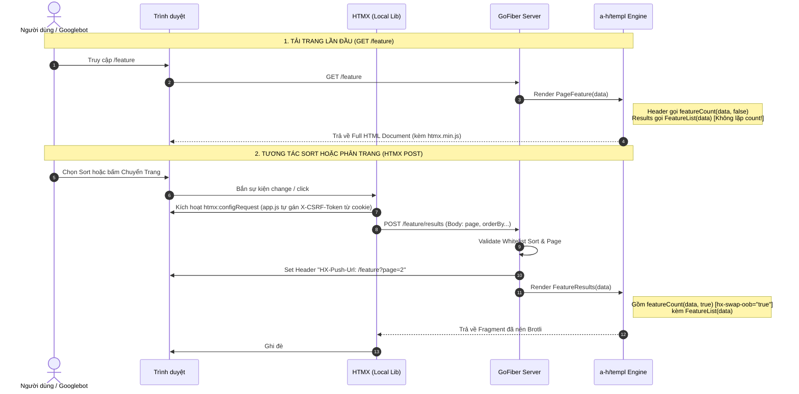

# HTMX Listing Pattern (Mô Hình Danh Sách Chuẩn Cho GoWeb)

Kỹ năng này định nghĩa **mô hình kiến trúc danh sách tối ưu** (Listing Pattern) được kiểm chứng từ module `news` trong dự án `sunway_goweb`. 

> [!IMPORTANT]
> **Quy Tắc Bắt Buộc Khi Làm Trang List Mới**:
> Mỗi khi người dùng yêu cầu tạo mới, làm lại hoặc nâng cấp bất kỳ trang danh sách nào (như danh sách Sản phẩm, Nhãn hàng, Đơn hàng, Bài viết, Catalogue...), Agent **BẮT BUỘC PHẢI GỢI Ý** cho người dùng:
> *"Bạn có muốn áp dụng mô hình HTMX Listing Pattern (như trang News: Server-Rendered Fragment, POST bảo mật CSRF, nén Brotli, URL SEO push, Zero-JS client) cho trang này không?"*

---

## 1. Tổng Quan Kiến Trúc (Architecture Overview)

Mô hình kết hợp sức mạnh của:
1. **Server-Side Rendering (Go + Templ)**: Render cực nhanh ở microsecond, tối ưu SEO.
2. **HTMX 2.x (Local Library)**: Nạp từ `/static/libs/htmx/htmx.min.js`, chỉ swap DOM fragment khi tương tác.
3. **POST Method + CSRF Tự Động**: Sort và phân trang dùng `hx-post` để chống bot spam crawling, tích hợp sẵn với cookie `csrf_` và header `X-CSRF-Token`.
4. **HX-Push-Url (SEO & UX)**: Cập nhật URL trình duyệt thành link GET shareable (`/news?orderBy=publish+desc&page=2`), người dùng F5 hoặc copy link vẫn mở đúng trang.
5. **Progressive Enhancement**: Bot tìm kiếm (Googlebot) không chạy JS vẫn crawl được qua thẻ `<a href="...">` của `PaginationHx`.
6. **Tách Fragment Chuẩn (Tránh Lặp Đếm)**: Tách `*List` và `*Results` để không bị nhân đôi dòng đếm `Showing X-Y of Z` khi tải trang lần đầu.

---

## 2. Luồng Hoạt Động (Request Lifecycle)



---

## 3. Quy Chuẩn Chi Tiết (Implementation Details)

### A. Template Views (`views/<feature>/index.templ`)

Luôn tổ chức thành **3 khối component tách bạch**:

```templ
package feature

import (
	"fmt"
	"goweb/modules/web/transport/responses"
	"goweb/views/layouts"
	"goweb/views/partials"
	"github.com/networld-solution/gos/templates"
)

// 1. Full Page: Dùng cho GET /feature
templ PageFeature(data *responses.FeatureListResp) {
	if data != nil {
		@layouts.Master(data.IsLogin, &[]templ.Component{featureCss()}, htmxJs()) {
			<main class="feature_page container">
				<header class="feature_head">
					<!-- Đếm số lượng lần đầu (oob = false) -->
					@featureCount(data, false)

					<!-- Form Sort dùng hx-post -->
					<form
						class="feature_sort"
						method="get"
						action="/feature"
						hx-post="/feature/results"
						hx-trigger="change"
						hx-target="#feature-results"
						hx-swap="innerHTML"
						hx-indicator="#feature-results"
					>
						<select id="feature-sort" name="orderBy">
							<option value="newest" selected?={ data.OrderBy == "newest" }>Newest First</option>
							<option value="oldest" selected?={ data.OrderBy == "oldest" }>Oldest First</option>
						</select>
					</form>
				</header>

				<!-- Vùng kết quả: KHÔNG gọi FeatureResults ở đây để tránh lặp đếm -->
				<div
					id="feature-results"
					class="feature_results"
					hx-target="this"
					hx-swap="innerHTML show:#feature-results:top"
					hx-indicator="#feature-results"
					hx-include="#feature-sort"
				>
					@FeatureList(data)
				</div>
			</main>
		}
	}
}

// 2. FeatureList: Lưới bài viết + Phân trang (dùng chung cho GET lần đầu và HTMX swap)
templ FeatureList(data *responses.FeatureListResp) {
	<div class="feature_grid">
		if len(data.Items) > 0 {
			for _, item := range data.Items {
				@partials.ItemCard(item)
			}
		} else {
			<p class="feature_empty">No items found.</p>
		}
	</div>
	<div>
		@partials.PaginationHx(data.CurrentPage, data.TotalPages, "/feature/results", func(p int) string {
			return featurePageURL(data.OrderBy, p)
		})
	</div>
}

// 3. FeatureResults: CHỈ DÙNG CHO HTMX RESPONSE (Cập nhật count OOB + List)
templ FeatureResults(data *responses.FeatureListResp) {
	@featureCount(data, true) // hx-swap-oob="true" tự cập nhật số lượng ở header
	@FeatureList(data)
}

// 4. Component Đếm Số Lượng
templ featureCount(data *responses.FeatureListResp, oob bool) {
	<p id="feature-count" class="feature_count" { featureCountAttrs(oob)... }>
		{ formatShowingCount(data.CurrentPage, len(data.Items), data.Total, data.Limit) }
	</p>
}

func featureCountAttrs(oob bool) templ.Attributes {
	if oob {
		return templ.Attributes{"hx-swap-oob": "true"}
	}
	return templ.Attributes{}
}

// Nạp HTMX local
templ htmxJs() {
	<script src={ templates.AssetURL("/static/libs/htmx/htmx.min.js") } defer></script>
}
```

---

### B. Handler GoFiber (`modules/web/transport/handlers/<feature>_hdl.go`)

Handler cần có **2 endpoint**:
1. `GET /feature`: Trả về full page (`PageFeature`).
2. `POST /feature/results`: Xử lý phân trang & sort, gửi header `HX-Push-Url`, trả về `FeatureResults`.

```go
// 1. GET Full Page
func (h *featureHdl) ListFeatureHdl() fiber.Handler {
	return func(c *fiber.Ctx) error {
		var req requests.FeatureReq
		_ = c.QueryParser(&req)
		req.Validate(c.Context())

		data, err := h.usc.ListFeatureUsc(c.Context(), &req)
		if err != nil {
			return err
		}

		return templates.Render(c, feature.PageFeature(data))
	}
}

// 2. POST Results Fragment cho HTMX
func (h *featureHdl) ListFeatureResultsHdl() fiber.Handler {
	return func(c *fiber.Ctx) error {
		var req requests.FeatureReq
		if err := c.BodyParser(&req); err != nil {
			return c.Status(fiber.StatusBadRequest).SendString("Invalid request")
		}
		req.Validate(c.Context())

		data, err := h.usc.ListFeatureUsc(c.Context(), &req)
		if err != nil {
			return err
		}

		// Tạo URL GET thân thiện cho thanh địa chỉ trình duyệt
		q := url.Values{}
		if req.OrderBy != "default" {
			q.Set("orderBy", req.OrderBy)
		}
		if req.Page > 1 {
			q.Set("page", strconv.Itoa(req.Page))
		}
		pushURL := "/feature"
		if len(q) > 0 {
			pushURL += "?" + q.Encode()
		}
		c.Set("HX-Push-Url", pushURL)

		// Chỉ render fragment kết quả
		return templates.Render(c, feature.FeatureResults(data))
	}
}
```

---

### C. Đăng Ký Route (`modules/web/routes_web.go`)

```go
// --- Feature ---
app.Get("/feature", featureComp.ListFeatureHdl())
app.Post("/feature/results", featureComp.ListFeatureResultsHdl())
```

---

### D. Chuẩn SEO & Accessibility Cho Item Card

Trong `views/partials/<item>_card.templ`:
- **KHÔNG DÙNG `rel="nofollow"`** cho link chi tiết nội bộ.
- Dùng **`aria-label`** chứa tiêu đề để tránh lỗi generic anchor text *"Read more"* / *"View detail"*:
  ```templ
  <a class="item_link" href={ templ.SafeURL(item.PagePath) } aria-label={ "View detail of " + item.Title } title={ item.Title }>
      <span>View detail</span>
  </a>
  ```
- Thêm **`loading="lazy"`** và **`decoding="async"`** cho ảnh card để tối ưu Core Web Vitals.

---

### E. Chuẩn Kebab-Case Cho Tham Số Sort Trên URL (Chống Khoảng Trắng / Dấu `+`)

Để URL hiển thị sạch sẽ, chuẩn SEO và không bị dính dấu cộng (`+`) hoặc mã hóa `%20`:

1. **Khai báo hằng số dùng dấu gạch nối (`kebab-case`)**:
   Trong `modules/web/common/consts/common_const.go`:
   ```go
   const (
       NEWS_SORT_NEWEST = "publish-desc" // KHÔNG DÙNG "publish desc"
       NEWS_SORT_OLDEST = "publish-asc"  // KHÔNG DÙNG "publish asc"
   )
   ```

2. **Ánh xạ sang SQL ORDER BY tại tầng UseCase**:
   Tầng UseCase nhận slug từ request và dùng `switch` chuyển thành cú pháp SQL tương ứng (vừa sạch URL, vừa chống SQL Injection 100%):
   ```go
   var sqlOrderBy string
   switch req.OrderBy {
   case consts.NEWS_SORT_OLDEST:
       sqlOrderBy = enum.ORDERBY_PUBLISH_ASC  // "publish ASC"
   default:
       sqlOrderBy = enum.ORDERBY_PUBLISH_DESC // "publish DESC"
   }
   filter.OrderBy = &[]string{sqlOrderBy}
   ```

---

## 4. Checklist Kiểm Tra Khi Triển Khai Mô Hình Này

- [ ] File HTMX nạp từ local: `/static/libs/htmx/htmx.min.js`.
- [ ] Header CSRF được gắn tự động qua `initHtmxCsrf()` trong `app.js`.
- [ ] Middleware nén `app.Use(compress.New())` đang bật trong `server_internal.go`.
- [ ] Tách rõ `FeatureList` (dùng cho Initial GET) và `FeatureResults` (dùng cho HTMX POST).
- [ ] Khung kết quả có `hx-include="#feature-sort"` để khi bấm phân trang vẫn giữ nguyên lựa chọn sort hiện tại.
- [ ] Handler POST có gán header `HX-Push-Url` đồng bộ URL thanh địa chỉ.
- [ ] Tham số sort trên URL dùng `kebab-case` (ví dụ: `publish-desc`, `publish-asc`), không chứa khoảng trắng, và được ánh xạ sang SQL ở UseCase.
- [ ] `formatShowingCount` tính toán dựa trên `data.Limit` động (không gán cứng số 12).
